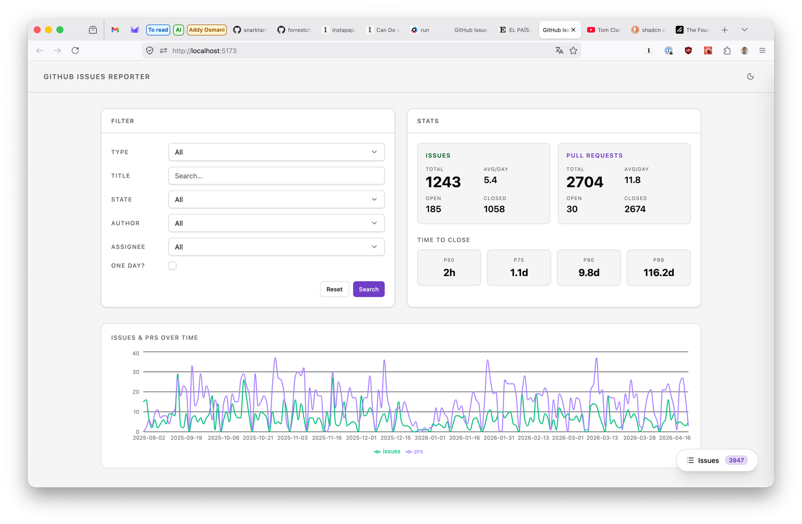

# GitHub Intelligence

> This is a pet project whose main goal is to learn patterns and better ways to work with AI for me. Do not expect specific features or maintenance.
>
> Collect GitHub issues and pull requests, explore them in your browser.

[](https://github.com/ydarias/github-intelligence/actions/workflows/ci.yml)


---

GitHub Intelligence is a monorepo that lets you pull issues and PRs from any GitHub repository for a given date range, cache them locally, and explore them through an interactive web dashboard — without keeping any remote infrastructure running.



## Features

- Fetch issues and pull requests for any public or private GitHub repository
- Fetch members of an organization
- Cache results locally — repeat queries are instant, no API calls made
- Interactive web dashboard with:
  - Summary stats (total, open, closed)
  - Issues and PRs over time chart
  - Filterable tables by author and assignee
  - Tabbed views: all items, same-day closures, still open, by author
- GitHub Enterprise support via a configurable base URL

## Built with

- [TypeScript](https://www.typescriptlang.org/) — strict, `NodeNext` module resolution throughout
- [Turborepo](https://turbo.build/) — monorepo task orchestration
- [@octokit/rest](https://github.com/octokit/rest.js) — GitHub REST API client
- [flat-cache](https://github.com/royriojas/flat-cache) — local disk cache
- [NestJS](https://nestjs.com/) — API server
- [Zod](https://zod.dev/) — schemas shared between the API and the UI
- [React](https://react.dev/) + [Vite](https://vitejs.dev/) — web dashboard
- [Recharts](https://recharts.org/) — data visualisation
- [Commander](https://github.com/tj/commander.js/) — CLI argument parsing

## Getting started

### Prerequisites

- Node.js >= 20
- npm >= 10
- A [GitHub personal access token](https://github.com/settings/tokens) (recommended to avoid rate limits)

### Installation

```bash
git clone https://github.com/your-org/github-intelligence.git

cd github-intelligence

npm install

npm run build
```

### Collect issues and PRs

Note: if you are going to use an Enterprise Github instance remember to give a value to the `GITHUB_BASE_URL` environment variable, e.g. `export GITHUB_BASE_URL=https://github.your-org.com/api/v3`.

```bash
export GITHUB_TOKEN=ghp_your_token_here

# Collect the last month of issues
node apps/cli/dist/index.js issues --repo facebook/react

# Or specify a date range
node apps/cli/dist/index.js issue --repo facebook/react --from 2024-01-01 --to 2024-03-31

# Or collect the last month of PRs
node apps/cli/dist/index.js prs --repo facebook/react

# Or collect the members of a given organization
node apps/cli/dist/index.js members --org facebook
```

### Open the dashboard

```bash
npm run dev
```

This starts the API on [http://localhost:3001](http://localhost:3001) and the UI on [http://localhost:5173](http://localhost:5173). Collect some issues with the CLI first, otherwise the API answers `404 No cached issues found`. Then visit [http://localhost:5173](http://localhost:5173).

Turbo only passes `CACHE_FOLDER`, `PORT`, `GITHUB_TOKEN` and `GITHUB_BASE_URL` through to `npm run dev`, so export them in your shell or put them in `apps/api/.env`.

## Project structure

```
github-intelligence/
├── apps/
│   ├── api/               # REST API — serves cached issues, members and stats (NestJS)
│   ├── cli/               # CLI — collects and prints issues/PRs
│   └── ui/                # Web dashboard (React + Vite)
└── packages/
    ├── api-contracts/     # Zod schemas and types shared by the API and the UI
    ├── github-client/     # Core library — GitHub API + client interface
    ├── issues/            # Issues and PRs collector and repository
    ├── members/           # Members collector and repository
    └── tsconfig/          # Shared TypeScript configuration
```

## Environment variables

| Variable          | Used by  | Description                                                     |
| ----------------- | -------- | --------------------------------------------------------------- |
| `GITHUB_TOKEN`    | CLI, API | GitHub personal access token                                    |
| `GITHUB_BASE_URL` | CLI      | GitHub API base URL (GitHub Enterprise)                         |
| `CACHE_FOLDER`    | CLI, API | Local cache directory (default: `/tmp/.cache/issues-collector`) |
| `PORT`            | API      | HTTP port for the API server (default: `3001`)                  |

The CLI and the API load a `.env` file automatically via `dotenv`, from their own directory (`apps/cli/.env`, `apps/api/.env`). The UI does not read any environment variables.

## Development

```bash
npm test          # run all tests
npm run type-check  # type-check all packages
npm run build     # build all packages and apps
npm run clean     # remove all build artifacts
```

## Contributing

Pull requests are welcome. For significant changes, open an issue first to discuss what you'd like to change.

## License

MIT
